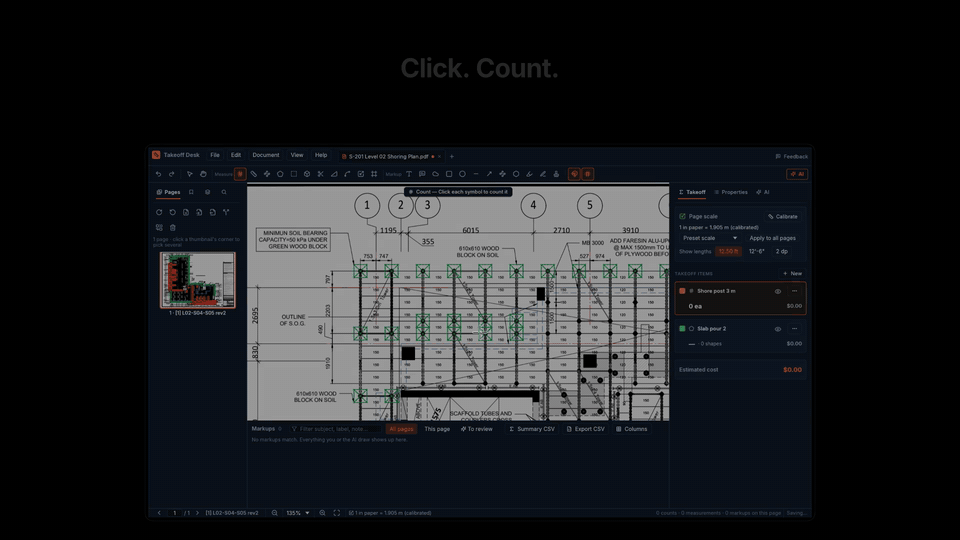

# Takeoff Desk

**Built in Rust. Super fast.** Bluebeam-style quantity takeoff with a built-in AI agent.

> ⚡ **Native Rust, no browser, no Electron.** An 859-page, 708 MB drawing set opens in **21 ms**.
> A full sheet renders in **~50 ms** at 200 DPI, and zoomed regions in **~15 ms**. PDF layers switch
> in **under 1 ms**. The whole app is a **47 MB** download and uses about **110 MB** of memory with a
> drawing open.

**Bluebeam-style quantity takeoff with a built-in AI agent.** Open a drawing set, then count,
measure and mark it up. Ask an agent to do the same on the sheet in front of you: it looks, sets
the scale, counts symbols, measures runs, reads title blocks, and checks its own work. It runs on
a local model on your machine, or on cloud models if you sign in to
[construction.live](https://construction.live).

▶ **[Watch the 74-second launch film](docs/media/Takeoff-Desk-launch.mp4)** (1080p).

**Download:**
- [macOS (Apple silicon)](https://pub-061018a047d54079b309fb16a26a1ce0.r2.dev/takeoff-desk/latest/Takeoff-Desk-arm64.dmg), signed and notarized
- [Windows 10/11 (x64)](https://pub-061018a047d54079b309fb16a26a1ce0.r2.dev/takeoff-desk/latest/Takeoff-Desk-x64-setup.exe), not code-signed yet (SmartScreen: *More info → Run anyway*); installs for you alone without admin rights

These links always point at the newest version.

- **Takeoff:**
  - Counts, lengths, perimeters, areas with cutouts, volumes and angles.
  - Scale presets, calibration and viewports.
  - Snapping to the drawing's own lines, and Follow Line.
  - Items with colors, hatches, unit costs and a Tool Chest.
- **Markups:**
  - Text, callouts, clouds, shapes, arrows, highlight, pen and stamps.
  - A Bluebeam-style Markups List with custom columns and CSV export.
- **PDF tools:**
  - Split, merge, extract, insert, rotate, delete and reorder pages. The takeoff follows its
    pages.
  - Compare revisions, layers, text search and bookmarks.
  - Slip-sheet a new revision over the old sheets (matched by sheet number, takeoff carried
    across, old pages kept for Compare), and group drawings into sets.
  - Flattened marked-up PDF export.
- **AI agent:**
  - Drawing tools, plus a shell in one workspace folder you choose (or turn off). Overlays of
    SVG, images or HTML on the sheet. You review everything it adds.
  - Local models through llama.cpp, with a memory check before loading. Cloud models through
    construction.live. Your own **Claude Code or Codex** subscription. Or any OpenAI-compatible
    endpoint.
- **For other tools:**
  - The `takeoff` CLI.
  - An MCP server, so Claude Desktop or Cursor can work a drawing.
  - A Claude Code plugin: `/plugin marketplace add constructionlive/takeoffbeam`, then
    `/plugin install takeoff-beam@takeoffbeam`. See [claude-plugin](claude-plugin/README.md).
- **Native and small:**
  - Rust, egui and pdfium. A 46 MB macOS download.
  - An 859-page set opens in 21 ms, and a full sheet renders in about 50 ms.
- **Plain files:** the takeoff is `plan.pdf.takeoff.json` next to the PDF, compatible with
  construction.live.

## Get it

- **macOS (Apple silicon):** [Takeoff-Desk-arm64.dmg](https://pub-061018a047d54079b309fb16a26a1ce0.r2.dev/takeoff-desk/latest/Takeoff-Desk-arm64.dmg), signed and notarized by Neuratwin Inc.
- **Windows 10/11 (x64):** [Takeoff-Desk-x64-setup.exe](https://pub-061018a047d54079b309fb16a26a1ce0.r2.dev/takeoff-desk/latest/Takeoff-Desk-x64-setup.exe). Not code-signed yet, so SmartScreen asks first (*More info → Run anyway*). Installs for everyone or only for you; only-for-you needs no admin rights. Silent: `/S /CurrentUser`.
- **From source:** `scripts/fetch-pdfium.sh && cargo run --release -p takeoff-app`.

See the [docs](docs/README.md):
- [Getting started](docs/getting-started.md)
- [Taking off](docs/takeoff.md)
- [PDF tools](docs/pdf-tools.md)
- [The AI agent](docs/ai.md)
- [CLI & MCP](docs/cli.md)
- [File format](docs/file-format.md)

## Crates

| Crate | |
|---|---|
| `takeoff-core` | Data model, geometry, numbering, snapping, coordinate dialects, undo, CSV, sidecar |
| `takeoff-pdf` | pdfium rendering, text, layers, vectors, page tools, burn-in, flattened export |
| `takeoff-models` | GGUF reader, memory-fit check, model catalog, downloads, llama-server |
| `takeoff-cloud` | construction.live sign-in and cloud models |
| `takeoff-agent` | The agent loop and drawing tools |
| `takeoff-app` | The desktop app |
| `takeoff-cli` | `takeoff` CLI + MCP server |

## License

Apache License 2.0; see [LICENSE](LICENSE). If you redistribute Takeoff Desk or something built
from it, keep the [NOTICE](NOTICE) file with it (License §4(d)) so construction.live is credited.

Third-party components:
- pdfium (BSD-3)
- Inter (SIL OFL 1.1), in `assets/fonts`
- Lucide icons (ISC), in `assets/fonts`
- llama.cpp (MIT), bundled in release builds
