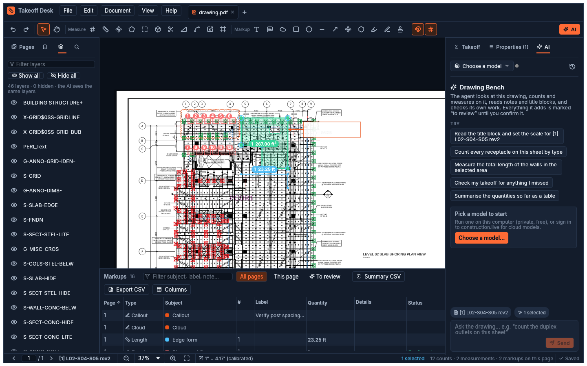

# The AI agent

The **AI** tab (⌘J) is a drawing agent that works on the sheet you have open. It can:
- read the title block and set the scale, checking it against a second dimension;
- count symbols, by sweeping the sheet tile by tile or matching a legend symbol;
- measure runs and areas, snapping its points onto the drawing's lines;
- read notes, schedules and tags;
- add callouts and clouds;
- review your takeoff for gaps.

It sees the sheet the way you do: same layers, same markups, numbered badges included.

## You stay in charge

- **Its marks wait for you.** Everything it adds is marked **to review**: dashed outline, "AI"
  author. Confirm items one at a time (Properties or right-click), per item (*Confirm all* in the
  Takeoff tab), or with *Edit → Confirm all AI marks*.
- **Its edits are undoable.** Every edit is an ordinary step in the undo history.
- **You can watch it.** While it works, an orange box on the canvas shows where it is looking.
  The chat shows each step (view, add marks, set scale…), with thumbnails of what it saw.
- **It works on this drawing, plus one folder of its own.** Besides the drawing tools below, it
  gets a shell in its **workspace folder** (default `Documents/Takeoff Desk/Workspace`) for
  scripts, data and overlay files. Turn that off, or pick another folder, in *Models* → *Let the AI
  run commands in a workspace folder*. Commands run as you, on this computer.
- **Follow it.** Turn on **Follow** (the crosshair at the top of the AI tab) and the canvas goes
  to the exact page and area the AI is looking at, switching tabs when it works in another
  drawing. A "Following the AI" pill shows while it works. Click **Stop** there, click the
  crosshair again, or just pan or zoom yourself to stop following.
- **Stop** ends the run at the next step.

The prompt line knows your context: the current page, the visible region when you are zoomed in,
and your selection. That makes "count these", "measure the selected wall" and "what's this note"
work.

To point it at one area, zoom to it and press **Attach view** above the prompt. The area becomes a
chip on your message, and the AI looks at exactly that area first and keeps its work there. Pan
or zoom and attach again to add more areas, even from other pages or open drawings. Click a chip
to go back to its area, in the prompt or later in the chat.

## Choosing a model

Click the model button at the top of the AI tab (or *Choose a model…*) to open **Models**.

### On this computer (private, free)

Local models run with llama.cpp on your machine, and your drawings never leave it. Use *Download*
for vision models that can read drawings (Qwen3.8 27B, Gemma 4 26B/12B/E4B/E2B), or *Import a
.gguf* for a model you already have. Models installed by construction.live Desktop are found
automatically.

**Before anything loads, Takeoff Desk checks whether the model fits.** It reads the model file's
header and adds up:
- the weights;
- the context cache (only the layers that have one; hybrid models like Qwen3.5+ cache 1 layer in
  4);
- the fixed recurrent state;
- the working buffers.

It compares that with what llama.cpp says your GPU may use. On Apple silicon that is the Metal
limit, e.g. 28.1 GB on a 36 GB Mac. The result is one of:
- **Fits**;
- **Tight**: close other apps first;
- **Not enough memory**: with the largest context that would fit.

*Compact context (Q8 cache)* halves the context memory with negligible quality loss.

### construction.live (cloud)

*Sign in with construction.live* shows a code and opens your browser. Approve the device there,
and Gemini, Claude, GPT and other cloud models appear, billed to your construction.live credits.
Your drawing images are sent to the model provider. The sign-in token is kept in the OS keychain.
*Sign out* forgets it.

### Custom endpoint

Any OpenAI-compatible server works: LM Studio, Ollama (`http://localhost:11434/v1`), vLLM,
OpenRouter, or a llama-server you run yourself. *Test & list models* checks the connection.

## How it sees coordinates

Models answer positions in different conventions:
- **Gemini:** a 0–1000 grid, `[y, x]`.
- **Qwen3-VL:** a 0–1000 grid, `[x, y]`.
- **Claude, GPT and most others:** pixels.

Takeoff Desk picks the convention per model, sizes each render so the model sees it unresized, and
converts every answer back to page positions in code. The model never does coordinate maths: it
reads positions off a numbered **view** (`v3`) and the tools convert them.

## Agent tools

| Tool | What it does |
|---|---|
| `get_drawing` | Pages, scales, items with counts, layers |
| `document_map` | The set's [document map](graph-view.md): what each sheet is, the areas on it, how they relate |
| `contact_sheet` | Up to 24 pages in one picture, with their title-block text, to survey a set |
| `map_sheets` / `map_add` / `map_remove` | Build the map: the sheet index, areas (boxed off a view) and links with a note on how they relate |
| `delegate` | Hand parts of a long job to subagents that run in parallel (the app's own agent; Claude Code uses its own `Agent` tool) |
| `view` | Render a page or region with markups and badges; registers a view id |
| `read_items` / `find_items_at` | List items (with the space each is in, or only one space's); find which item is at a spot in a view |
| `add_marks` / `add_measurements` | Count marks; lengths, areas, angles (optionally snapped to lines). `path: follow` runs a length along the drawing's own line between the points (curves, dashes, crossings); `path: smooth` curves through them |
| `update_items` / `delete_items` | Edit or remove items |
| `create_category` / `update_category` | Takeoff items |
| `summary` | Counts and totals per item, per space and per page |
| `add_annotation` | Clouds, callouts, text, arrows… |
| `set_scale` / `set_scale_preset` / `check_scale` / `calibrate` | Scale from a dimension, a printed scale, or automatically; measure-back check |
| `detect` | Tiled symbol sweep, optionally against a legend crop |
| `trace` | Trace polylines/polygons with vision |
| `read_text` / `search_text` | The PDF's own text with positions |
| `set_hidden_layers` | Layer visibility (shared with you) |
| `fill_area` | Measure a space by a point inside it: the outline the drawn lines make around it, doorways closed (vector and scanned sheets). Several points fill together as one area |
| `follow_line` | Measure a whole connected run from one point |
| `set_viewport` | Show where it's looking |
| `switch_drawing` | Move its tools to another open drawing (tab) |
| `add_overlay` / `update_overlays` | Lay an SVG, image or HTML page over part of the sheet, semi-transparent |
| `bash` | Run a command in the workspace folder (bash; PowerShell on Windows) |

### Several drawings at once

Open several PDFs (*File → Open* takes many at once, or drop them on the window). The chat belongs
to the tab you're in, and the AI can also work in every other open tab. A chip above the prompt
shows how many. For example: "compare the panel schedule on E-601 with the plan", or "carry the
scale from the architectural set to the structural one". Each drawing keeps its own takeoff. A mark
the AI places always lands in the drawing it was looking at, and appears in that tab, undoable as
usual.

### Workspace and overlays

With the workspace on, the agent can run commands (python, node, curl… whatever is installed) in
its folder. `TAKEOFF_PDF` holds the drawing's path, and files stay between turns. Commands start in
the workspace, but they run as you with your permissions. Codex is the exception: its own sandbox
confines writes to the folder.

Overlays let it **show** things on the sheet itself: zones, a site map, a heat map of quantities,
a colour-coded correlation between sheets. Each one is an SVG, a PNG/JPEG, or an HTML page. HTML
is rendered to a transparent image with Google Chrome or Microsoft Edge, which must be installed.
Overlays sit under your markups. Show or hide them, change their opacity or delete them under
**Overlays** in the Takeoff tab. They are saved with the takeoff but not in exports. Overlays
made from image or HTML files point at the file in the workspace, so keep it there.

The same tools are available to other AI apps through the [MCP server](cli.md#mcp).

## What to expect from local models (measured)

These are measurements from Qwen3.8 27B (Q4_K_M) on an M3 Max with 36 GB.

- **Coordinates.** The model's boxes were exactly right: 23 of 23 symbols on target with the
  Qwen 0–1000 `[x,y]` convention. The other conventions scored 10 of 23 and 0 of 23.
- **Scale.** It set the scale from a grid dimension and checked it back against a second
  dimension within 2.4%. On another run it rejected a bad automatic calibration (40% cross-check
  disagreement) and set the scale by hand instead.
- **Speed.** About 30–140 s per step, so a 15-step job takes 10–30 minutes. Use a cloud model for
  interactive work, or a smaller local model. Thinking is off by default for local models; turn
  it on in *Models* for hard sheets.
- **Not yet verified with a live local model:** full symbol sweeps (`detect`), `trace` and
  `follow_line`. They are covered by tests with a scripted model.

To measure a model yourself, use `takeoff eval probe` (how accurately it places boxes, in each
convention) and `takeoff eval run` (whole jobs on sheets with known answers). On the synthetic
sheets, Qwen3.8 27B put 18 of 18 boxes on target in its own convention; Gemma 3 4B put none. See
[Evals](evals.md).

## Your own Claude Code or Codex, or OpenCode's free models

If you already pay for Claude or ChatGPT, *Models → Subscriptions* runs the agent on the Claude
Code or Codex CLI installed on your computer, under the sign-in you already have. Takeoff Desk
never sees or stores your credentials.

- The CLI runs headless in your AI workspace folder, with its own shell and file tools (Claude
  Code: Bash, Read, Write, Edit, Glob, Grep; Codex: its workspace-write sandbox). With the workspace
  turned off, it runs in an empty folder of ours with only the drawing tools. The drawing tools
  come from the app over a private local MCP bridge, so marks appear live and are undoable like any
  other.
- Usage counts against your plan's limits, not construction.live credits.
- Not installed or not signed in? *Subscriptions* has **Install** and **Sign in** buttons. Each
  opens a Terminal window that runs the installer or the sign-in, which continues in your browser.
  The card updates by itself when it's done. Codex installs with npm, so it needs
  [Node.js](https://nodejs.org) first; the card says so and links to it.
- **OpenCode** is the free option. Its free models include **DeepSeek V4.1 Flash**, which can read
  drawings, and no account is needed. Models you've added to OpenCode with your own provider keys
  show up too. Only models that can see images and call tools are listed. Two catches: OpenCode's
  free tier only runs with OpenCode's own setup, including its shell, so it **needs the AI
  workspace turned on** and works inside that folder. And the free list changes as OpenCode
  rotates models.
- Needs **Claude Code 2.1.40** or newer, **Codex 0.140.0** or newer, or **OpenCode 1.18.33** or newer. With an older one,
  *Subscriptions* says so and offers **Update** (`claude update`, or npm for Codex). Turns don't
  start until it's updated.
- Codex is found even when it only ships inside the ChatGPT desktop app. Sign in once with
  `codex login`.
- Symbol sweeps (`detect`, `calibrate`, `trace`) make their own vision calls. They use your
  construction.live model or a loaded local model.

> Takeoff Desk never handles OAuth tokens or credentials. It launches the unmodified Claude
> Code or Codex that you signed in to yourself, and gives it the drawing tools over MCP.
