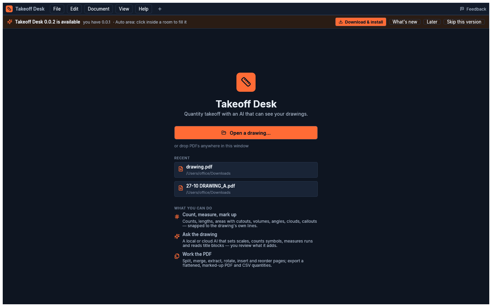

# Building & releasing

```sh
scripts/fetch-pdfium.sh            # vendor/pdfium (chromium/7881, matches pdfium-render 0.9)
cargo test --workspace             # unit + parity + UI interaction tests
cargo run -p takeoff-app           # the app (debug)
```

## Tests

- **Parity:** `crates/takeoff-core/tests/parity.rs` checks badge numbering, measurement maths,
  unit keys and vision-coordinate sizing against golden outputs from construction.live's
  TypeScript. Maintainers regenerate the fixtures with `PLATFORM=… scripts/parity/gen.sh`.
- **UI interaction:** `crates/takeoff-app/tests/interaction.rs` drives the real UI with simulated
  input: count, calibrate, length, area, undo, delete, autosave.
- **UI snapshots:** run
  `SNAP_DIR=/tmp/snaps cargo test -p takeoff-app --test snapshots -- --ignored`. It renders the
  window headless (wgpu) in dark and light themes, and those images are the ones in these docs.

## macOS package

```sh
scripts/package-macos.sh                                          # ad-hoc signed, dist/*.dmg
SIGN_IDENTITY="Developer ID Application: Neuratwin Inc. (8T3B74J76Z)" scripts/package-macos.sh
NOTARIZE=1 APPLE_ID=… APPLE_TEAM_ID=… APPLE_APP_SPECIFIC_PASSWORD=… SIGN_IDENTITY=… scripts/package-macos.sh
```

The bundle (about 46 MB as a dmg) contains:
- the app;
- the `takeoff` CLI;
- `libpdfium.dylib` (in Frameworks);
- llama.cpp's `llama-server` and its dylibs: the newest official ggml-org build, or set
  `LLAMA_TAG=b11617` to pin one.

Every Mach-O is signed inside-out with the hardened runtime.

## Windows installer

```sh
brew install mingw-w64 makensis      # once (macOS); or run on Windows / in CI
scripts/package-windows.sh           # → dist/Takeoff-Desk-<version>-x64-setup.exe
```

The script cross-compiles with mingw-w64 (with the icon and version info embedded) and fetches:
- `pdfium.dll`;
- llama.cpp's **Vulkan** build, which runs on NVIDIA, AMD and Intel GPUs and falls back to CPU;
- the Visual C++ runtime DLLs that llama.cpp needs, taken from Microsoft's redistributable and
  put next to the programs (app-local), so nothing needs installing system-wide.

The NSIS installer adds a Start-menu and desktop shortcut, an *Open with → Takeoff Desk* entry for
PDFs, and an uninstaller in Add/Remove Programs. It installs either for everyone (Program Files,
HKLM, needs admin) or for the current user only (`%LOCALAPPDATA%\Programs\Takeoff Desk`, HKCU,
no admin). Admin accounts choose on a page and default to everyone; other accounts install for
themselves. A later version installs in the same mode as the copy it finds. Silent installs take
`/S` with `/CurrentUser` or `/AllUsers`.

`.github/workflows/release.yml` builds the same installer natively (MSVC) on a Windows runner for
every `v*` tag, installs it silently for the current user as a check, and attaches it to the
GitHub release.

### Signing

The installer is not Authenticode-signed yet, so Windows SmartScreen shows "unknown publisher".
To sign, set `WIN_SIGN` to a command that signs the file named after it, in place. The script then
signs every exe and DLL it ships (except Microsoft's runtime, already signed by Microsoft), the
uninstaller and the installer. For example, with Azure Artifact Signing (formerly Trusted
Signing) and [jsign](https://ebourg.github.io/jsign/), which runs on macOS:

```sh
WIN_SIGN='jsign --storetype TRUSTEDSIGNING --keystore eus.codesigning.azure.net \
  --storepass "$(az account get-access-token --resource https://codesigning.azure.net -q accessToken -o tsv)" \
  --alias <account>/<certificate-profile> --tsaurl http://timestamp.acs.microsoft.com' \
  scripts/package-windows.sh
```

On Windows, `signtool sign /fd sha256 /tr … /td sha256 …` works the same way.

## Linux

The code is portable (egui/wgpu, pdfium, llama.cpp) and CI builds and tests it on Ubuntu.
A packaged AppImage is on the roadmap.

## Shipping an update

Every installed copy checks the update feed at launch and every 6 hours:
`https://pub-061018a047d54079b309fb16a26a1ce0.r2.dev/takeoff-desk/latest.json` (Cloudflare R2).
If that fails, it falls back to the latest GitHub release. When the feed has a newer version, a
banner offers **Download & install**: it downloads the dmg or setup.exe for the user's platform
into Downloads and opens it. It also has *What's new*, *Later* and *Skip this version*.
*Help → Check for updates…* runs the check on demand.

1. Bump `version` in the root `Cargo.toml`.
2. Build the installers:
   - `SIGN_IDENTITY=… NOTARIZE=1 … scripts/package-macos.sh`
   - `scripts/package-windows.sh`
3. Publish, with R2 credentials in the environment:
   ```sh
   NOTES="- Auto area\n- Faster thumbnails" scripts/publish-update.sh
   ```
   Add `CRITICAL=1` for a fix users can't skip. Add `DRY_RUN=1` to preview the manifest.
4. Optionally tag `vX.Y.Z` and push. CI builds the Windows installer and attaches it to the
   GitHub release.



## Feedback

*Feedback* (top right, or *Help → Send feedback…*) opens the user's email app with a message to
rahul@construction.live. The subject and body are pre-filled with the version, OS and the model
in use.

## Crash reports

If the app panics, a hook writes a report (message, file and line, thread, backtrace, version,
OS) to `crash.txt` in the logs folder: `~/Library/Application Support/Takeoff Desk/logs` on
macOS, `%APPDATA%\Takeoff Desk\logs` on Windows. On the next start a small notice in the
bottom-right corner offers *Send report…*, which opens the same Feedback email with the head of
the report in it and the file's path to attach, or *Dismiss*. Either way the report is renamed
`crash-<time>.txt` and kept. Nothing is sent unless the user clicks.

*Help → Copy diagnostics* puts the version, OS, model, logs folder and the last crash on the
clipboard; *Help → Show logs* opens the folder.
