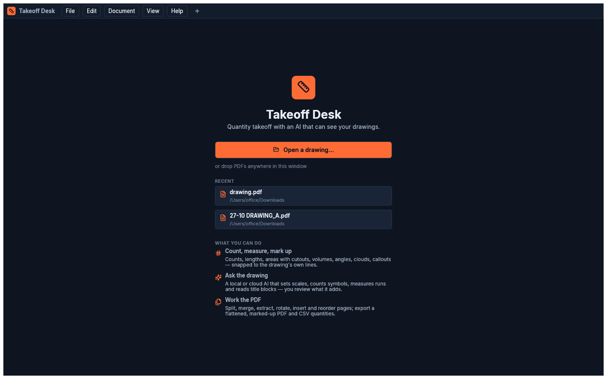

# Getting started

## Install

**macOS (Apple silicon):** download `Takeoff-Desk-<version>-arm64.dmg`, drag *Takeoff Desk* to
Applications. Everything it needs is inside the app: the PDF engine (pdfium), llama.cpp for local
models, and the `takeoff` command-line tool (`Takeoff Desk.app/Contents/Resources/bin/takeoff`).

**Windows 10/11 (x64):** run `Takeoff-Desk-<version>-x64-setup.exe`. On an administrator
account it asks whether to install for everyone on the computer (Program Files) or only for you;
other accounts install for themselves, in `%LOCALAPPDATA%\Programs\Takeoff Desk`, with no admin
rights needed. Silent install: `/S`, adding `/CurrentUser` or `/AllUsers` to choose. Updates
install where the current copy is.

The Windows installer is not code-signed yet, so SmartScreen says *Windows protected your PC*
and names an unknown publisher: choose *More info → Run anyway*. Only the macOS app is signed and
notarized.

**From source** (any platform with Rust 1.85+):

```sh
git clone https://github.com/constructionlive/takeoffbeam && cd takeoffbeam
scripts/fetch-pdfium.sh
cargo run --release -p takeoff-app            # the app
cargo install --path crates/takeoff-cli       # the `takeoff` CLI
```

For local AI on a source build, install llama.cpp (`brew install llama.cpp`) or point
Preferences → llama-server at a `llama-server` binary.

## Open a drawing

*File → Open* (⌘O), drop PDFs on the window, or pick a recent file on the start screen. Each
drawing opens in a tab.

From Finder or Explorer, right-click a PDF and choose *Open With → Takeoff Desk*; the installer
adds it there without making it your default PDF app (set that yourself if you want
double-click). On macOS a PDF sent while the app is running opens as a new tab. On Windows each
file starts its own window. `takeoff-desk plan.pdf` opens a drawing from a terminal. Your takeoff is saved automatically, about a second after each change, to
`<drawing>.pdf.takeoff.json` next to the PDF. The status bar shows **Saved**.



## The window

```
┌ File Edit Document View Help │ tabs ───────────────────────────────────────────┐
│ ↶ ↷ │ Select Pan │ Measure: Count Length Perimeter Area … │ Markup: Text … │ ⌁ # │ AI │
├──────────┬──────────────────────────────────────────────────┬──────────────────┤
│ Pages    │                                                  │ Takeoff          │
│ Bookmarks│                drawing canvas                    │ Properties       │
│ Layers   │                                                  │ AI               │
│ Search   ├──────────────────────────────────────────────────┤                  │
│          │ Markups list (sortable, filterable, CSV)         │                  │
├──────────┴──────────────────────────────────────────────────┴──────────────────┤
│ ‹ 3 / 52 › sheet │ − 100% + ⤢ │ scale 1/4" = 1'-0" · x 12'-6" y 30'-1" │ Saved │
└──────────────────────────────────────────────────────────────────────────────┘
```

- **Navigate:** on a trackpad, two fingers pan and pinch zooms. A mouse wheel zooms
  (*Preferences → Mouse wheel* can make it scroll instead). Hold **Space** or drag with the wheel
  button to pan with any tool. **PgUp/PgDn** for pages, **⌘0** to
  fit the page.
- **Pages one after another:** *View → Page layout* (or the buttons beside the zoom) shows a
  single page, continuous pages, or two pages side by side (⌘4–⌘7). See
  [Several pages on screen](takeoff.md#several-pages-on-screen).
- **Tools:** each has a one-letter shortcut. Press **?** for the full list.
- **Light or dark:** *View → Theme* (it follows the system by default).

Next: [Taking off](takeoff.md).
