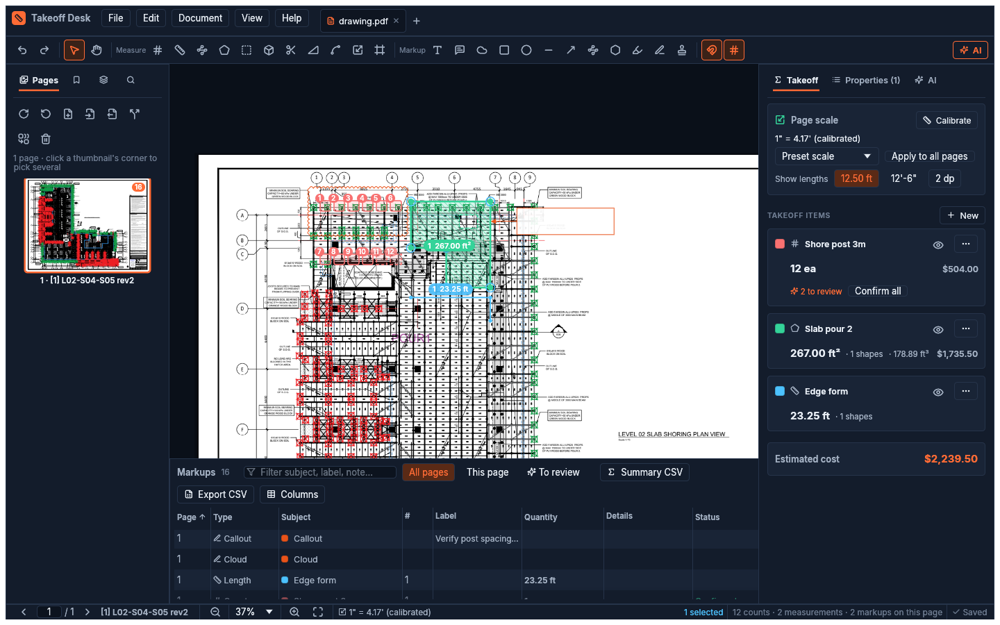

# Taking off

All quantities live in **takeoff items**: a named, colored group such as "Duplex receptacle",
"Edge form" or "Slab pour 2", of one kind (count, length or area). The **Takeoff** tab lists
them with totals and cost. Click an item to keep taking off into it.

## Set the scale first

Each page has its own scale. There are three ways to set it:

- **Preset:** *Takeoff → Preset scale*. Choose from architectural (1/32" = 1'-0" … 3" = 1'-0"),
  engineering (1" = 10' … 1" = 200') or metric (1:1 … 1:1000). A PDF page's size *is* its paper
  size, so a printed scale is exact without clicking anything.
- **Calibrate (K):** click both ends of a known dimension, then type its real length: `22'-6"`,
  `22' 6 1/2"`, `12.5`, `3.2 m`, `150mm`. Tick *Use for all pages of the same size* to apply it
  across the set.
- **Viewport (Z):** drag around a detail drawn at a different scale, then pick its scale.
  Measurements inside the viewport use it; everything else uses the page scale.

The status bar shows the active scale and the cursor's real-world position. *Show lengths* switches
between `12.50 ft` and `12'-6"`.

## Tools

| Tool | Key | How |
|---|---|---|
| Count | C | Click each symbol. Every click adds a numbered mark. |
| Length | L | Click points; double-click or Enter to finish; Backspace removes the last point. |
| Curve | | A length along a smooth curve through the points you click: click a few along the bend (more on a tight one); double-click or Enter to finish. |
| Trace line | | Click points **on** a drawn line (its start, its end, anywhere it forks): the length runs along that line between them, through dashes and past lines that cross it. |
| Perimeter | P | Like Length, but closes the loop. |
| Area | A | Click the corners; double-click or Enter closes it. Shows area and perimeter. |
| Fill area | | Click inside a room or any space bounded by lines: it is outlined along the drawn lines. Shift-click another piece to add it. |
| Rectangle area | B | Drag a rectangle. |
| Volume | U | An area, then you type its depth (e.g. 0.33 ft for a 4" slab). Shows yd³ too. |
| Cutout | X | Select an area, then click the corners of the hole to subtract. |
| Angle | G | Click arm, vertex, arm. |
| Follow line | F | Click a line on the drawing: the whole connected run becomes one length. |
| Calibrate | K | See above. |
| Viewport | Z | See above. |

**Snapping (S)** clips your clicks to the drawing's own vector lines:
- ■ endpoint
- ▲ midpoint
- ✕ intersection
- ◆ on the line

Hold **Alt** to place a point freely and **Shift** to lock to 0/45/90°. Scanned sheets have no
vectors, so snapping quietly does nothing there.

**Curves.** *Curve* and *Trace line* measure curved runs (track, roads, curbs, pipe), and the
*Curve* markup tool draws a curved line. *Trace line* uses the PDF's own line work, and on scans,
flattened sheets and lines drawn over aerial photos it follows the line's colour in the picture.
Both points of a span must be on one drawn line: a centreline that isn't drawn (midway between
two rails) can't be traced. Where no single line joins two points, that span stays straight.

Either way the result is an ordinary length (or markup): the curve is stored as many short
segments, so its value is right in the Takeoff list, the exports and construction.live.

**Fill area.** One click measures a room, a slab, a paved area or an opening. The outline follows
the inside face of the lines around the point, so text, tags and symbols inside the space count as
part of it. Doorways and other openings close by themselves with a straight line from jamb to
jamb. On a page with a scale the openings tried are real widths (a door, a pair of doors, a wide
opening); without a scale they are paper widths. If a line crosses the space (a stair in an
opening, an X across a shaft, a hatch edge), only the piece you clicked fills: **Shift-click**
each other piece to join them into one area. If the space is open to the rest of the page,
nothing is filled and the status bar says so; use *Area* and click its corners. It works on scans
too.

## Several pages on screen

*View → Page layout*, or the four buttons in the status bar, shows one page at a time (the
default), **Continuous** (pages one under another, scrolling from one to the next), **Two pages**
side by side, or two pages continuous. *Cover page on its own* starts the spreads at page 2, like
a book. **⌘4 / ⌘5 / ⌘6 / ⌘7** switch between them; the choice is remembered.

- **The current page** is the one under the middle of the view as you scroll. The page box,
  the highlighted thumbnail, *This page* filters, the status bar and the AI all follow it.
- **Paging** (PgUp/PgDn, the page box, thumbnails, bookmarks, search hits, links) scrolls to the
  page and keeps the zoom. *Fit page* and *Fit width* fit the current page (its spread, with
  spreads).
- **Tools work on the page under the pointer.** A click there makes it the current page.
- **A shape stays on its page.** Once you have clicked its first point, clicks on another page
  are ignored (the status bar says so): finish it with Enter or a double-click, or Esc. A drag that
  runs off the page stops at its edge. Clicks in the gaps between pages don't start anything.
- **It is only a view.** Every count, measurement and markup still belongs to one page, with the
  same undo and the same saved takeoff, whichever layout you use.
- **Large sets stay quick.** Pages are laid out from their sizes, and only the ones on screen (and
  just beyond) are drawn, a few at a time.

## Spaces

A **space** is a named region of a sheet: a level, a unit, a room ("Level 2", "Unit 204",
"Kitchen"). Every quantity inside a space belongs to it, so you can see what is in each one.
Start from **Spaces → New** in the Takeoff tab:

- **Draw a space:** click its corners like an area; double-click or Enter to close.
- **Fill a space:** click inside a room; it is outlined along the drawn lines, like *Fill area*.
  Shift-click the next piece to add it.

A new space is selected and named "Space 1", "Space 2"…; rename it in **Properties**, or
double-click its name in the list. The list shows spaces as a tree, each under the space it sits
in. From it you can recolor, hide (it still counts) and delete a space (its quantities stay). On
the sheet a space shows as a tinted, dashed outline with its name: click the outline or the name
to select it, drag it to move it, and drag a corner to reshape it.

**Which space an item is in:**
- A count: the space around the middle of its mark. An angle: around its vertex. A markup:
  around the middle of its bounds.
- An area: around a point inside it (its centre, or for an L-shaped area the middle of the
  widest span across it at that height).
- A length that crosses a boundary is not split: it belongs to the deepest space holding more
  than half of it, else to the space holding the most of it. A run half in the kitchen and half
  in the bath belongs to the unit around both. Totals are the same with or without spaces.
- Spaces nest by shape: one drawn inside another is inside it, with no extra step. The
  smallest space around an item wins, and the item's space is shown with its full path:
  `Level 2 › Unit 204 › Kitchen`.
- An outline counts as inside, so a mark on the wall between two rooms goes to the smaller room
  (for rooms of the same size, the one drawn last).

Where spaces show:
- **Takeoff tab:** *Totals for* limits the item totals to one space and the spaces inside it.
  *By space* lists the totals per space; each quantity counts once, in its deepest space, so the
  groups add up to the whole.
- **Markups List:** a *Space* column (sortable and searchable), and a space filter that includes
  the spaces inside the one you pick.
- **CSV:** the markups CSV has a *Space* column. With spaces, *Summary CSV* has one line per space
  and item, with the space first.
- **The AI:** `read_items` gives each item's space and can list one space's items; `summary`
  totals per space.

## Editing

- **Select (V):**
  - Click an item, or drag on empty space to box-select. Shift/⌘ adds to the selection.
  - In the **Markups** list: click a row, ⌘-click to add or remove one, Shift-click for a range, or
    **Select all** (follows the filters). The bar above the list confirms or deletes the selection.
  - Drag a selection to move it, and nudge it with the arrow keys (Shift = ×10).
  - Drag a vertex to reshape, or a corner to resize.
  - **Delete** removes the selection.
- **Edit commands:** ⌘C / ⌘V / ⌘D copy, paste and duplicate. ⌘Z / ⇧⌘Z undo and redo, with 200
  steps.
- **Right-click menu:** confirm, move to another item, lock/unlock, duplicate, delete.
- **Properties tab:** every detail of the selection:
  - the item, label, note, depth, perimeter/closed and custom-column values;
  - status (*Pending* / *Confirmed* for AI marks; *Accepted*, *Rejected*, *Completed*… for
    markups);
  - author and date.

## Items, styles and the Tool Chest

Each item's **⋯** menu sets:
- **Color.**
- **Line style:** solid, dashed or dotted.
- **Hatch:** diagonal, cross or grid.
- **Opacity.**
- **Unit cost:** gives a cost column and an estimated total.
- **Description for the AI:** e.g. "circle with two parallel lines".

*Save to Tool Chest* keeps an item's style and cost for every future drawing. *New → From Tool
Chest* reuses it.

## Markups List

The bottom panel lists every count, measurement and markup with these columns: page, space, type,
subject (item), number, label, quantity, details (perimeter / volume), status, author, date, your
custom columns, and note.
- **Sort:** click a header.
- **Filter:** by text, *This page*, *To review*, or a space.
- **Jump:** click a row to go to the item; double-click to zoom to it.
- **Custom columns:** add them under *Columns*. Edit the values in Properties.
- **Export:** *Export CSV* writes the full list; *Summary CSV* writes one line per item (count or
  total, unit, volume, unit cost, cost), or one per space and item when there are spaces.
  *Excel* writes both into one `.xlsx`: a *Markups* sheet, a *Summary* sheet with a total cost
  row, and with spaces a *By space* sheet. Pages, numbers, values, counts and costs are real
  numbers, so sums and filters work in Excel.
